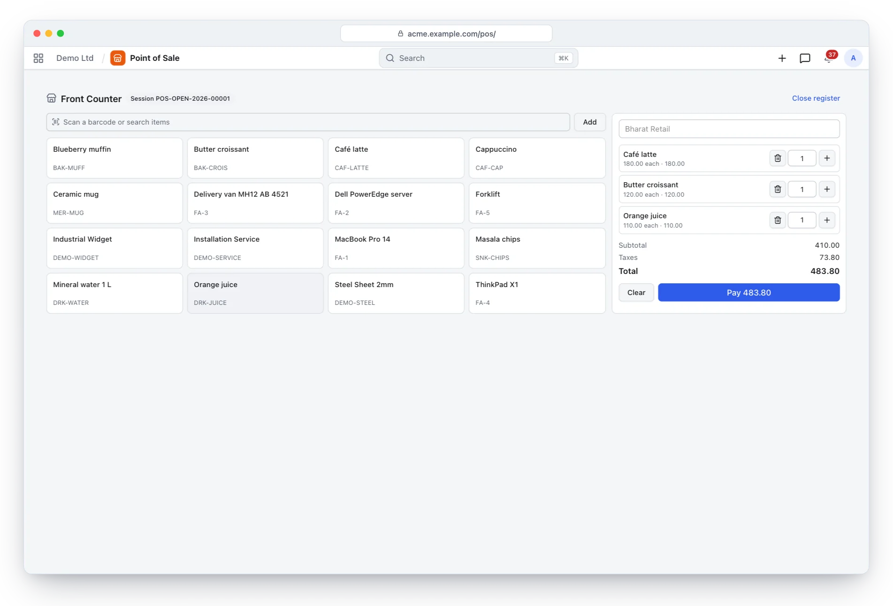
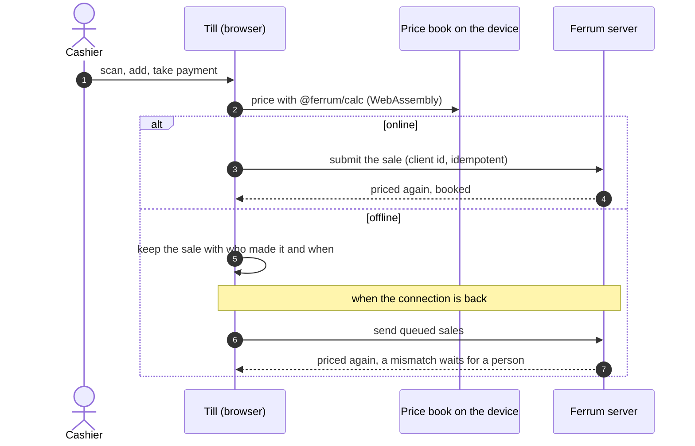
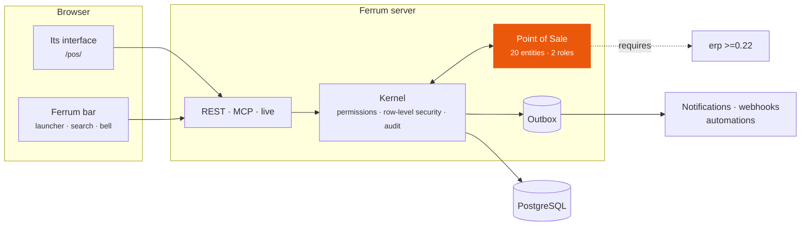
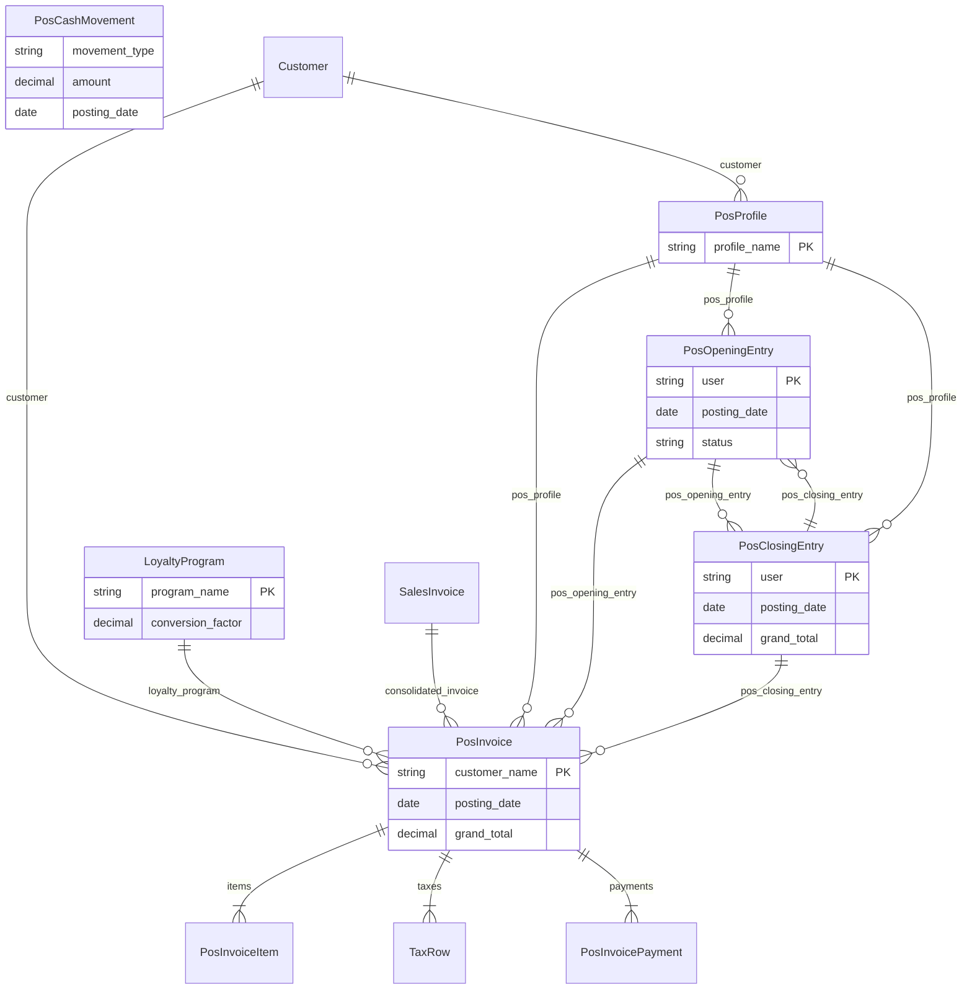

<div align="center">

<picture>
  <source media="(prefers-color-scheme: dark)" srcset="docs/assets/banner-dark.svg">
  
</picture>

[](https://github.com/CBFerrum/ferrum-app-pos/actions/workflows/ci.yml)      

**A native app for [Ferrum](https://github.com/CBFerrum/Ferrum), the open-source, AI-first business platform.**

[Overview](#overview) · [Highlights](#highlights) · [Screenshots](#screenshots) · [How it works](#how-it-works) · [Data model](#data-model) · [Install](#install) · [Develop](#develop) · [Changelog](#changelog)

</div>

---

## Overview

Ferrum Point of Sale is the till at `/pos/`: full screen, installable on its own, and able to
sell offline. Its worker keeps the till's page and files, the register's price book stays on the
device, and the till prices sales, promotions and taxes included, with ERP's pricing engine compiled to
WebAssembly, so offline totals are the server's totals. Sales made offline wait on the device and go when the connection,
or the cashier's session, is back; at closing they consolidate into invoices and payments. A sale
made offline that takes more than the warehouse holds when it arrives follows the register's policy:
recorded, with a Stock Shortfall a manager puts right, or refused.


| At a glance | |
|---|---|
| 📦 Version | `0.5.0` |
| 🧱 Platform | Ferrum `>=0.3.1, <0.4` |
| 🔗 Requires | erp `>=0.1` |
| 🖥️ Interface | its own, at `/pos/` |
| 🗃️ Records | 20 entities in 1 package |
| 👥 Roles | 2: Cashier, POS Manager |
| 📊 Reports | 6 |
| 🧪 Tests | 10 Rust tests, 8 interface test files |


## Highlights

<table>
<tr>
<td width="50%" valign="top">

### 📴 Sells offline
The page, files and price book stay on the device; queued sales go when the connection returns. Sold past the stock, they are kept with a shortfall to put right, or refused, as the register says.

</td>
<td width="50%" valign="top">

### 🧮 The server's own engine
Offline totals, promotions and the tax by rate come from ERP's pricing crate in WebAssembly, the code the server prices the sale again with.

</td>
</tr>
<tr>
<td width="50%" valign="top">

### 💳 Split payments
Cash, bank, credit and loyalty tenders, change in large type, a line editor and discounts within the cashier's limits.

</td>
<td width="50%" valign="top">

### 🔎 Scan, hold and return
A scan box that is always ready, pack barcodes, sales on hold, and a returns desk that refunds the way a sale was paid.

</td>
</tr>
<tr>
<td width="50%" valign="top">

### 🧾 Closing into the books
The drawer counted at the till against what is expected, with a Z report; sales then consolidate into invoices and payments per method, with cash differences booked.

</td>
<td width="50%" valign="top">

### 📲 Installable
Installs as an app of its own, opening <code>/pos/</code> in its own window. Receipts, copies and the shift report are templates the workspace edits.

</td>
</tr>
</table>

## Screenshots

<picture>
  <source media="(prefers-color-scheme: dark)" srcset="docs/assets/pos-dark.webp">
  
</picture>

<p align="center"><sub>The till: items, the cart and payment, full screen.</sub></p>

> [!TIP]
> The screenshots follow your GitHub theme: switch between light and dark to see both.

## How it works

### A sale, online or offline



### Inside Ferrum



Everything Point of Sale adds is ordinary Ferrum metadata and Rust: its records get lists, forms,
search, permissions, an audit trail, exports and the REST and MCP APIs for free, so AI agents work
with them under the same rules as people.

### What it adds to Ferrum

| Where | What |
|---|---|
| 🚀 Launcher | **Point of Sale** at `/pos/` — installable on its own |

## Data model

The main records and how they connect (20 entities in all; `packages/` has every field).



### Roles

| Role | What it is for | Entities |
|---|---|---|
| **Cashier** | Sells at a register - opens own sessions, rings up sales and returns, records cash movements, counts the drawer. | 23 |
| **POS Manager** | Runs the shop - registers, every session and sale, discounts beyond the cashier limit, voids, closings and consolidation. | 24 |

<details>
<summary><b>Reports (6)</b></summary>

- Pos Sales Summary
- Pos Daily Sales
- Pos Payment Reconciliation
- Pos Top Items
- Pos Hourly Sales
- Pos Returns

</details>

## Install

Workspace administrators install it from **Apps** (`/store/`) in Ferrum; it ships in the
official Ferrum server image. It needs **erp** `>=0.1` installed first. Self-hosters building their own image enable the
`pos` feature of the server. Everything it adds is also available to AI agents over
Ferrum's MCP server, within each person's permissions.

## Develop

Clone it next to the platform:

```text
work/
├── ferrum/            https://github.com/CBFerrum/Ferrum (with Ferrum-Frontend cloned into ferrum/web)
└── ferrum-app-pos/
```

Point the platform dependencies at your checkout (this file is git-ignored):

```toml
# .cargo/config.toml
[patch."https://github.com/CBFerrum/Ferrum"]
ferrum-calc = { path = "../ferrum/crates/calc" }
ferrum-domain = { path = "../ferrum/crates/domain" }
ferrum-kernel = { path = "../ferrum/crates/kernel" }
ferrum-meta = { path = "../ferrum/crates/meta" }
```

The tests need PostgreSQL with an ordinary (non-superuser) role, so row-level security
applies:

```bash
createuser ferrum --pwprompt && createdb -O ferrum ferrum_pos_test
cargo test
```

`FERRUM_POS_TEST_DATABASE_URL` overrides the database URL.


It also builds on [ferrum-app-erp](https://github.com/CBFerrum/ferrum-app-erp), which Cargo takes from GitHub.
To work on it alongside this app, clone it into the same folder and add to the same file:

```toml
[patch."https://github.com/CBFerrum/ferrum-app-erp"]
ferrum-app-erp = { path = "../ferrum-app-erp" }
```


The interface lives in `ui/` and builds with Ferrum-Frontend's packages:

```bash
cd ui
npm run build      # ui/dist, checked against the size budget
npm test
```

With a development server started with `FERRUM_DEV_UI=1`, `ferrum-app dev --ui` serves the pages
from Vite behind the real bar and session, with hot reload.


### Project layout

```text
app.yaml      the manifest: id, version, requirements, what it adds to Ferrum
packages/     metadata: entities, roles, reports, workflows, print formats
src/          the app's logic in Rust: hooks, actions, endpoints, upkeep jobs
ui/           its own interface (React + Vite), built into ui/dist
tests/        integration tests against a real PostgreSQL
CHANGELOG.md  what changed in each version
```

## Changelog

| Version | Highlights |
|---|---|
| **0.7.4** | Fixes from the browser walk: the shift screen no longer crashes when opened from the till, and a register with no default customer asks who is buying (a picker in the payment step) instead of showing a walk-in buyer the server then refuses. |
| **0.7.3** | The till for 0.7.2: ERP's pricing crate vendored as WebAssembly (loaded only to price a sale offline, kept by the worker) prices offline sales from the schema 1 snapshot with promotions, free items and the tax by rate, and a 0.7.1 snapshot is let go; returns and exchanges show the server's plan; the blind close shows only the figures the server sends. |
| **0.7.2** | Server only, needs ERP 0.26: offline prices from ERP's one pricing crate (the snapshot is its schema 1; an offline sale priced again with it, its promotions recorded and counted once, in the Promotions Given report); blind close reveals no expected figure before the count; the returns plan covers exchanges; a shift's tax rows exact across the upgrade; buyer erasure tested. |
| **0.7.1** | The till's screens for 0.7.0: a buyer's registration and promotion codes at payment, the server's receipt printed once with copies, gift receipts and receipts by message, returns found by scanning a receipt with the register's refund plan and exchanges against a receipt, safe drops, a blind close and the shift report through the server's template, the snapshot kept for selling offline with the totals sent for the register to check, and the reviewer's list of Price Differences. |
| **0.7.0** | A buyer's tax registration gets a tax invoice at the sale; the receipt is a template the workspace edits, with the tax by rate, registrations, tenders and a barcode, and its copies and gift receipts are counted; receipts by message; ERP's promotions on POS sales; one signed snapshot of prices, taxes and promotions for the till offline, with each offline sale priced again against it; a refund plan and a window on returns; safe drops, blind close and a shift report. |
| **0.6.2** | Needs ERP 0.22.0: modes of payment and their accounts are ERP's, with the till's type, stored-value kind, offline limit and account added to them as the same columns, so nothing moves on upgrade. |
| **0.6.1** | The till's screens for 0.6.0: limits read from the server, another person's PIN to approve what is beyond them, voids with a reason, gift cards and store credit sold, taken and refunded onto, returns without a receipt and exchanges, and the tax invoice at once. |
| **0.6.0** | Limits by role, approval by another person's PIN for one sale that lapses, voids with reasons, gift cards and store credit at the till, a sale invoiced at once, a return policy, returns without a receipt and exchanges. |
| **0.5.2** | Rebuilt on the tuned design system: better menu icons, a lighter first page, a visible scroll cue, cleaner print. |
| **0.5.1** | The redesigned interface: the upgraded design system, shaped loading, told-apart states. |
| **0.5.0** | Offline sales beyond stock follow the register's policy: recorded with a Stock Shortfall to put right, or refused. |
| **0.4.13** | Its reports' names in Arabic and Hindi. |
| **0.4.12** | Its names in Arabic and Hindi; the last English sentences translated. |
| **0.4.11** | Sentences built in code are words too, in Arabic and Hindi. |
| **0.4.10** | The assistant knows its records. |
| **0.4.9** | Rebuilt with Ferrum-Frontend 5b22e7b: its own words in Arabic and Hindi. |
| **0.4.8** | Rebuilt with Ferrum-Frontend 6537d65: once-shown answers kept; English isolated right to left; its own words translatable by a workspace. |
| **0.4.7** | Rebuilt with Ferrum-Frontend d5d98f2: a workspace's own interface words; pictures in attachment fields; a duplicate value said so; its own screens mirror right to left. |
| **0.4.6** | Rebuilt with Ferrum-Frontend 63280d3: right to left, pages mirror; the records pages' words in Arabic and Hindi. |
| **0.4.5** | Rebuilt with Ferrum-Frontend a64416a: a box whose default is 1 shows ticked; action dialogs say every refusal and ask once. |
| **0.4.4** | A customer's loyalty balance over every point entry, not one page of 500. |
| **0.4.3** | Rebuilt with Ferrum-Frontend a76295e: times on a person's own clock when they chose one. |
| **0.4.2** | Times on the workspace's clock; rebuilt with Ferrum-Frontend 24c3951. |
| **0.4.1** | Rebuilt with Ferrum-Frontend bb60115: empty numbers read as the server reads them; settings open as their record. |
| **0.4.0** | The price book and the register's memory kept under the workspace's offline lease, for the person signed in; queued sales kept until sent |
| **0.3.3** | Rebuilt with Ferrum-Frontend 00dea07: a workflow state's kept fields are read-only, its needed ones required. |
| **0.3.2** | Rebuilt with Ferrum-Frontend daeadda: actions say what they did. |
| **0.3.1** | Rebuilt with Ferrum-Frontend 80ff179: labels name their fields, and linked titles show their titles. |
| **0.3.0** | The till rebuilt for a queue (scan box always ready, keyboard shortcuts, a line editor, a new pay window, hold and resume), a returns desk, and opening and closing a shift with a counted drawer and a Z report … |
| **0.2.3** | Selling offline prices as the server does with the platform's newer engine (Ferrum-Frontend 9ecf5bf, built from Ferrum b5b2d3f, localization.md … |
| **0.2.2** | Installable on its own: a till's browser offers to install Point of Sale as an app of its own, which opens `/pos/` in its own window with the … |
| **0.2.1** | The register's records (lists, forms, reports, apps' screens) load when first opened, so the till's first script is 186 KB compressed, within the … |
| **0.2.0** | Its own interface at `/pos/`: the till, full screen, and the register's records (profiles, sessions, sales, closings, loyalty) in the records … |

Every version is in [CHANGELOG.md](CHANGELOG.md).

## License

[AGPL-3.0-only](LICENSE), like the platform. Part of [Ferrum](https://github.com/CBFerrum/Ferrum) ·
[Report an issue](https://github.com/CBFerrum/ferrum-app-pos/issues)
