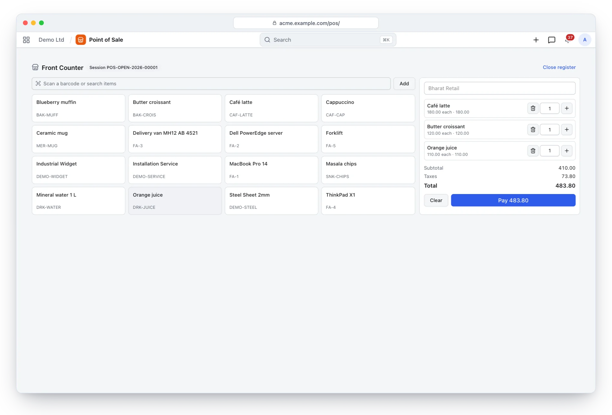
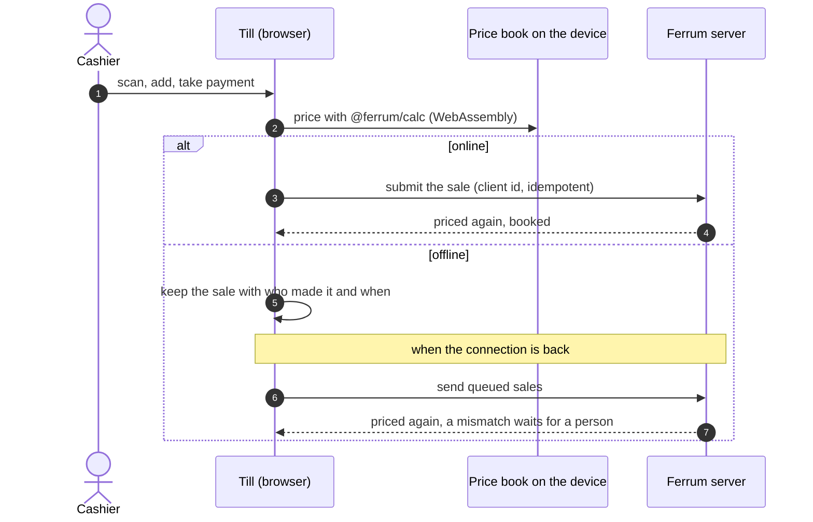
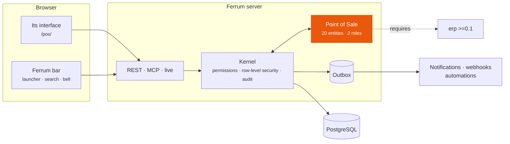
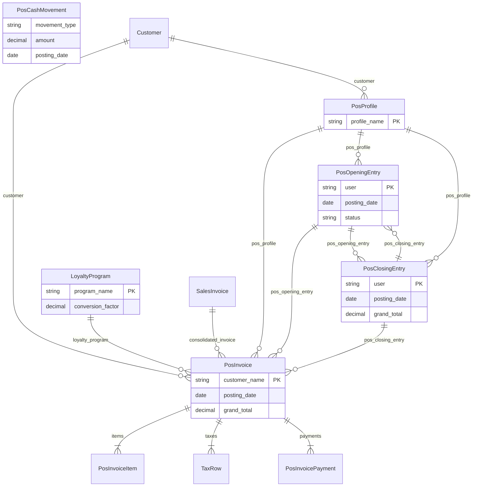

<div align="center">

<picture>
  <source media="(prefers-color-scheme: dark)" srcset="docs/assets/banner-dark.svg">
  
</picture>

[](https://github.com/CBFerrum/ferrum-app-pos/actions/workflows/ci.yml)      

**A native app for [Ferrum](https://github.com/CBFerrum/Ferrum), the open-source, AI-first business platform.**

[Overview](#overview) · [Highlights](#highlights) · [Screenshots](#screenshots) · [How it works](#how-it-works) · [Data model](#data-model) · [Install](#install) · [Develop](#develop) · [Changelog](#changelog)

</div>

---

## Overview

Ferrum Point of Sale is the till at `/pos/`: full screen, installable on its own, and able to
sell offline. Its worker keeps the till's page and files, the register's price book stays on the
device, and the till prices sales with the server's own engine compiled to WebAssembly, so offline
totals are the server's totals. Sales made offline wait on the device and go when the connection,
or the cashier's session, is back; at closing they consolidate into invoices and payments.


| At a glance | |
|---|---|
| 📦 Version | `0.2.2` |
| 🧱 Platform | Ferrum `>=0.3.1, <0.4` |
| 🔗 Requires | erp `>=0.1` |
| 🖥️ Interface | its own, at `/pos/` |
| 🗃️ Records | 20 entities in 1 package |
| 👥 Roles | 2: Cashier, POS Manager |
| 📊 Reports | 6 |
| 🧪 Tests | 8 Rust tests, 2 interface test files |


## Highlights

<table>
<tr>
<td width="50%" valign="top">

### 📴 Sells offline
The page, files and price book stay on the device; queued sales go when the connection returns.

</td>
<td width="50%" valign="top">

### 🧮 The server's own engine
Offline totals come from the platform's pricing engine in WebAssembly (<code>@ferrum/calc</code>).

</td>
</tr>
<tr>
<td width="50%" valign="top">

### 💳 Split payments
Cash, bank, credit and loyalty tenders, change and discounts within limits.

</td>
<td width="50%" valign="top">

### 🔎 Scan and search
Barcode lookup in one query, pack barcodes, returns against the original sale.

</td>
</tr>
<tr>
<td width="50%" valign="top">

### 🧾 Closing into the books
Sales consolidate into invoices and payments per method, with cash differences booked.

</td>
<td width="50%" valign="top">

### 📲 Installable
Installs as an app of its own, opening <code>/pos/</code> in its own window.

</td>
</tr>
</table>

## Screenshots

<picture>
  <source media="(prefers-color-scheme: dark)" srcset="docs/assets/pos-dark.webp">
  
</picture>

<p align="center"><sub>The till: items, the cart and payment, full screen.</sub></p>

> [!TIP]
> The screenshots follow your GitHub theme: switch between light and dark to see both.

## How it works

### A sale, online or offline



### Inside Ferrum



Everything Point of Sale adds is ordinary Ferrum metadata and Rust: its records get lists, forms,
search, permissions, an audit trail, exports and the REST and MCP APIs for free, so AI agents work
with them under the same rules as people.

### What it adds to Ferrum

| Where | What |
|---|---|
| 🚀 Launcher | **Point of Sale** at `/pos/` — installable on its own |

## Data model

The main records and how they connect (20 entities in all; `packages/` has every field).



### Roles

| Role | What it is for | Entities |
|---|---|---|
| **Cashier** | Sells at a register - opens own sessions, rings up sales and returns, records cash movements, counts the drawer. | 23 |
| **POS Manager** | Runs the shop - registers, every session and sale, discounts beyond the cashier limit, voids, closings and consolidation. | 24 |

<details>
<summary><b>Reports (6)</b></summary>

- Pos Sales Summary
- Pos Daily Sales
- Pos Payment Reconciliation
- Pos Top Items
- Pos Hourly Sales
- Pos Returns

</details>

## Install

Workspace administrators install it from **Apps** (`/store/`) in Ferrum; it ships in the
official Ferrum server image. It needs **erp** `>=0.1` installed first. Self-hosters building their own image enable the
`pos` feature of the server. Everything it adds is also available to AI agents over
Ferrum's MCP server, within each person's permissions.

## Develop

Clone it next to the platform:

```text
work/
├── ferrum/            https://github.com/CBFerrum/Ferrum (with Ferrum-Frontend cloned into ferrum/web)
└── ferrum-app-pos/
```

Point the platform dependencies at your checkout (this file is git-ignored):

```toml
# .cargo/config.toml
[patch."https://github.com/CBFerrum/Ferrum"]
ferrum-calc = { path = "../ferrum/crates/calc" }
ferrum-domain = { path = "../ferrum/crates/domain" }
ferrum-kernel = { path = "../ferrum/crates/kernel" }
ferrum-meta = { path = "../ferrum/crates/meta" }
```

The tests need PostgreSQL with an ordinary (non-superuser) role, so row-level security
applies:

```bash
createuser ferrum --pwprompt && createdb -O ferrum ferrum_pos_test
cargo test
```

`FERRUM_POS_TEST_DATABASE_URL` overrides the database URL.


The interface lives in `ui/` and builds with Ferrum-Frontend's packages:

```bash
cd ui
npm run build      # ui/dist, checked against the size budget
npm test
```

With a development server started with `FERRUM_DEV_UI=1`, `ferrum-app dev --ui` serves the pages
from Vite behind the real bar and session, with hot reload.


### Project layout

```text
app.yaml      the manifest: id, version, requirements, what it adds to Ferrum
packages/     metadata: entities, roles, reports, workflows, print formats
src/          the app's logic in Rust: hooks, actions, endpoints, upkeep jobs
ui/           its own interface (React + Vite), built into ui/dist
tests/        integration tests against a real PostgreSQL
CHANGELOG.md  what changed in each version
```

## Changelog

| Version | Highlights |
|---|---|
| **0.2.2** | Installable on its own: a till's browser offers to install Point of Sale as an app of its own, which opens `/pos/` in its own window with the … |
| **0.2.1** | The register's records (lists, forms, reports, apps' screens) load when first opened, so the till's first script is 186 KB compressed, within the … |
| **0.2.0** | Its own interface at `/pos/`: the till, full screen, and the register's records (profiles, sessions, sales, closings, loyalty) in the records … |
| **0.1.1** | Requires the ERP app: installing it in a workspace without ERP installs ERP whole, with its interface, rather than a few of its packages. |

Every version is in [CHANGELOG.md](CHANGELOG.md).

## License

[AGPL-3.0-only](LICENSE), like the platform. Part of [Ferrum](https://github.com/CBFerrum/Ferrum) ·
[Report an issue](https://github.com/CBFerrum/ferrum-app-pos/issues)
